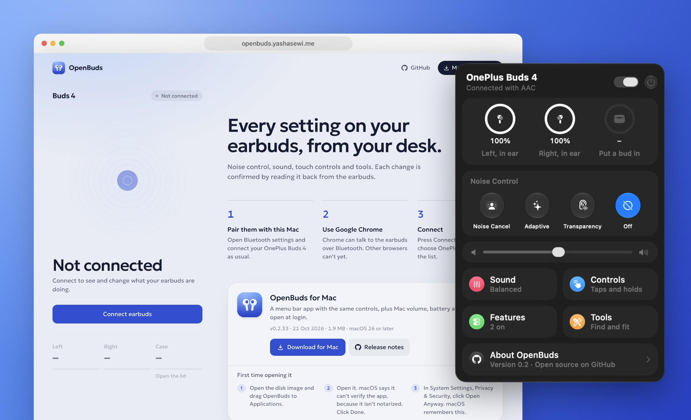
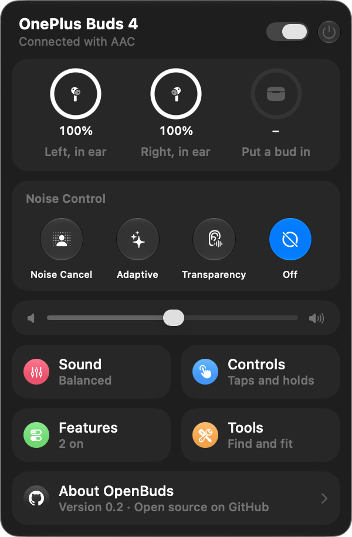
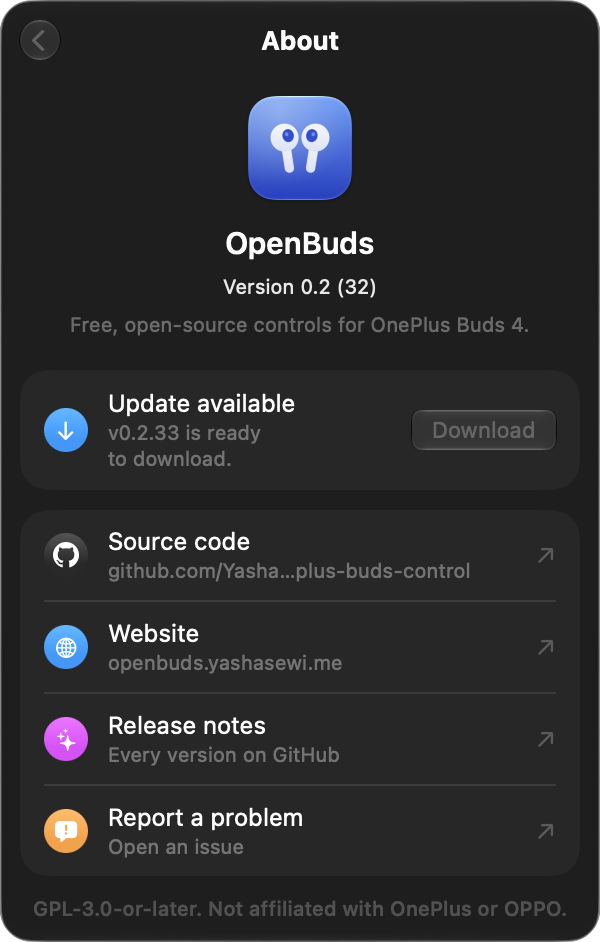

<p align="center">
  
</p>

<h1 align="center">OpenBuds</h1>

<p align="center">
  Every setting on your <b>OnePlus Buds 4</b>, from a Mac menu bar app or a Chrome tab.<br>
  Free and open source. No account, no cloud, no phone.
</p>

<p align="center">
  <a href="https://github.com/Yashasewi/openbuds/releases/latest/download/OpenBuds.dmg"></a>
  <a href="https://openbuds.yashasewi.me"></a>
</p>

<p align="center">
  <a href="https://github.com/Yashasewi/openbuds/releases/latest"></a>
  <a href="https://github.com/Yashasewi/openbuds/releases"></a>
  
  <a href="LICENSE"></a>
</p>

<p align="center">
  
</p>

## What it does

| | Mac app | Web app |
|---|:---:|:---:|
| Battery and in-ear status for each bud and the case | ✓ | ✓ |
| Noise cancelling, Adaptive, Transparency, and ANC strength | ✓ | ✓ |
| Equalizer presets and your own custom EQ | ✓ | ✓ |
| Tap and hold gestures, call controls, noise-control cycle | ✓ | ✓ |
| Wear detection, game mode, dual connection, smart volume, BassWave, 3D audio | ✓ | ✓ |
| Find my earbuds, fit test, Golden Sound hearing test | ✓ | ✓ |
| Mac output volume, low-battery alerts, connect card, open at login | ✓ | |

Every change waits for the earbuds to accept it, then reads the setting back, so what you see is what the earbuds are actually doing.

<p align="center">
  
  &nbsp;&nbsp;
  
</p>

## Install the Mac app

1. Download **[OpenBuds.dmg](https://github.com/Yashasewi/openbuds/releases/latest/download/OpenBuds.dmg)**. It needs macOS 26 or later on Apple silicon.
2. Open the disk image and drag **OpenBuds** to **Applications**.
3. Open OpenBuds. The first time, macOS says it can't verify the app. Click **Done**, open **System Settings → Privacy & Security**, and click **Open Anyway**. macOS remembers that choice.
4. Allow Bluetooth when macOS asks. If the earbuds are connected to the Mac, OpenBuds finds them by itself.

<details>
<summary>Why does macOS warn about the app?</summary>

The release is ad-hoc signed, so macOS knows the file hasn't been changed, but it isn't notarized with a paid Apple Developer ID. Right-click **Open** no longer skips the warning on macOS 15 and later, so **Open Anyway** is the way in. Building the app yourself (below) avoids the warning entirely.
</details>

<details>
<summary>The menu bar icon doesn't appear</summary>

Open **System Settings → Menu Bar** and turn on **OpenBuds**. On a crowded menu bar, macOS may also hide it behind the notch.
</details>

<details>
<summary>It can't connect</summary>

Only one app can hold the earbuds' control link. Quit HeyMelody, and close any Chrome tab that's connected to the web app. Then click **Connect** in the panel.
</details>

## Use the web app

Open **[openbuds.yashasewi.me](https://openbuds.yashasewi.me)** in desktop Google Chrome, click **Connect earbuds**, and choose **OnePlus Buds 4**. The earbuds must already be paired with your computer. Chrome talks to them over Web Serial, which other browsers don't support yet.

## Build from source

You need macOS 26 or later and Xcode from the App Store.

```sh
git clone https://github.com/Yashasewi/openbuds.git
cd openbuds/native
./scripts/build-app.sh --install
```

That builds a release, signs it for your Mac, copies it to `/Applications/OpenBuds.app`, and opens it. The app has to run as a bundle, because macOS only opens Bluetooth RFCOMM channels for apps.

The web app needs Node.js 22.18 or newer and pnpm:

```sh
cd app
pnpm install
pnpm dev
```

Then open [localhost:5173](http://localhost:5173/) in Chrome. Use `localhost`, not `127.0.0.1`: Chrome remembers the earbuds per address.

## Limits

- OnePlus Buds 4 only, tested on firmware 138.138.105.
- Hi-Res audio needs the LHDC codec. macOS connects with AAC, so the earbuds refuse Hi-Res on a Mac.
- Firmware updates, factory reset, pairing, and HeyMelody's cloud features are not implemented.

## Privacy

OpenBuds talks only to your earbuds. The Mac app asks GitHub for the newest release when you open its About page. The web app asks GitHub for the same thing to show the download version. Nothing else leaves your computer.

## Contributing

Bug reports and pull requests are welcome. Read [CONTRIBUTING.md](CONTRIBUTING.md) first: work goes into `dev`, and releases go from `dev` to `main`. The wire format is in [PROTOCOL.md](PROTOCOL.md).

## Credits

- [QuickBuds](https://github.com/spizganed/QuickBuds) by spizganed, GPL-3.0-or-later. The command bitmap is based on `desktop/src/types.rs`, with some entries changed.
- [OppoPodsManager](https://github.com/Zhaoyi-ya/OppoPodsManager), GPL-3.0-or-later. An earlier protocol write-up.
- [Pods-Protocol](https://github.com/Star-ZER0/Pods-Protocol-Reverse-Engineering), CC-BY-SA-4.0. A format reference.
- [Geologica](https://fonts.google.com/specimen/Geologica), through `@fontsource-variable/geologica`.

Protocol details in [PROTOCOL.md](PROTOCOL.md) come from QuickBuds' published captures and probes of the author's own earbuds, with the source named for each fact. Items not yet confirmed are marked TODO.

## License

[GPL-3.0-or-later](LICENSE).

## Disclaimer

OpenBuds is an independent, community project. It is not affiliated with, endorsed by, sponsored by, or supported by OnePlus, OPPO, realme, HeyTap or any of their affiliates. OnePlus, OnePlus Buds, OPPO, realme and HeyMelody are trademarks of their respective owners. They're used here only to say which devices OpenBuds is compatible with. OpenBuds includes no firmware, logos, images or other assets from OnePlus, OPPO or HeyMelody. Protocol details come from QuickBuds' published captures and probes of the author's own earbuds. Items not yet confirmed are marked TODO.

Use it at your own risk. It comes with no warranty and may stop working after a firmware or app update. Changing settings with unofficial tools may affect your warranty or support, so check your warranty terms. Please don't contact OnePlus or OPPO support about OpenBuds. Open an issue here instead.
